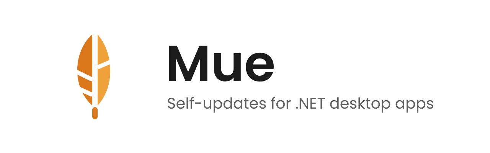

<p align="center">
  <picture>
    <source media="(prefers-color-scheme: dark)" srcset="docs/images/mue-banniere-sombre.png">
    
  </picture>
</p>

<p align="center">
  <b>Mise à jour automatique pour applications de bureau .NET.</b><br> Rechercher, télécharger, fermer ce qui bloque, installer — avec l'accord de l'utilisateur, en WPF et Avalonia.
</p>

<p align="center">
  <a href="README.md">English</a> ·
  <a href="docs/guide.fr.md">Guide d'intégration</a> ·
  <a href="CHANGELOG.md">Historique</a>
</p>

<p align="center">
  <picture>
    <source media="(prefers-color-scheme: dark)" srcset="https://raw.githubusercontent.com/syl-craft/Mue-media/main/videos/01-update-flow-dark.gif">
    
  </picture>
</p>

## Pourquoi Mue

- **Éprouvé.** Le moteur de mise à jour de [DockPad](https://github.com/syl-craft/DockPad), sorti en bibliothèque une fois éprouvé en production. Il équipe aujourd'hui DockPad, PicaLite et AlterVNC.
- **Rien ne s'installe dans le dos de l'utilisateur.** Mue liste les programmes qui utilisent vos fichiers et demande avant de les fermer.
- **S'adapte à votre appli.** Vos textes, votre thème, votre source de mises à jour ; le cœur ne connaît ni WPF ni Velopack.

## Fonctionnalités

| Fonctionnalité | |
|---|---|
| 🔎 **Recherche planifiée** | Première recherche 20 s après le démarrage, puis au plus toutes les 6 h ; annulée à l'arrêt |
| 🏷️ **Pastille de version** | Un contrôle `UpdateBadge` autonome : `v1.2.0 → 1.3.0`, un clic vers la fenêtre de mise à jour |
| 📝 **Notes de version** | Notes Markdown, progression et état dans une fenêtre prête à l'emploi |
| 🛑 **Programmes bloquants** | Liste ce qui utilise vos fichiers, par groupe ; on en ferme, on laisse le reste à l'installeur |
| ✅ **Accord explicite** | Quand l'appli annonce des effets, l'utilisateur confirme avant que rien ne se passe |
| 🎨 **Thèmes** | Clair, sombre ou suivre Windows ; vos brosses l'emportent ; contraste WCAG AA vérifié |
| 🌍 **Textes** | Anglais et français intégrés ; chaque clé se surcharge, les clés manquantes se testent |
| ⌨️ **Ligne de commande** | `MonAppli.exe update --json` pour les scripts et les agents IA, avec codes de sortie |
| 🖥️ **Plateformes** | Windows (WPF, Avalonia) et macOS 15+ (Avalonia) |

## En images

<table>
  <tr>
    <td width="50%" valign="top">
      <picture>
        <source media="(prefers-color-scheme: dark)" srcset="https://raw.githubusercontent.com/syl-craft/Mue-media/main/videos/02-blockers-dark.gif">
        
      </picture>
      <p align="center"><b>Programmes bloquants</b><br>On en ferme, on laisse le reste à l'installeur</p>
    </td>
    <td width="50%" valign="top">
      <picture>
        <source media="(prefers-color-scheme: dark)" srcset="https://raw.githubusercontent.com/syl-craft/Mue-media/main/videos/04-confirmation-dark.gif">
        
      </picture>
      <p align="center"><b>Accord explicite</b><br>Échap reporte, seul Confirmer installe</p>
    </td>
  </tr>
  <tr>
    <td width="50%" valign="top">
      <picture>
        <source media="(prefers-color-scheme: dark)" srcset="https://raw.githubusercontent.com/syl-craft/Mue-media/main/videos/03-badge-dark.gif">
        
      </picture>
      <p align="center"><b>Pastille de version</b><br>Votre version, jusqu'à la suivante</p>
    </td>
    <td width="50%" valign="top">
      <p><b>Ligne de commande</b></p>

```powershell
$r = & .\MonAppli.exe update --json | Out-String
# {"status":"updated","current":"1.2.0",
#  "available":"1.3.0","blockers":[]}
```

<p>Un code de sortie par cas : à jour, installée, disponible, bloquée, accord requis.</p>
    </td>
  </tr>
</table>

## Démarrage rapide

```sh
dotnet add package Mue.Velopack
dotnet add package Mue.Wpf        # ou Mue.Avalonia
```

```csharp
using Mue;
using Mue.Velopack;

UpdateTexts.AppName = "Mon application";

var service = new UpdateService(
    new VelopackBackend(new VelopackBackendOptions("https://github.com/vous/mon-app")),
    new UpdateServiceOptions { PendingStore = new FileUpdatePendingStore(pendingPath) });

service.StartPolling();                                // recherche planifiée
new Mue.Wpf.UpdatesDialog(service, host).ShowDialog(); // ou une UpdateBadge liée
```

`host` est votre `IUpdateDialogHost` : il prépare et quitte votre appli, et trouve les programmes bloquants.
Tant que Mue n'est pas sur nuget.org, ajoutez d'abord le flux local : voir [Publication locale](docs/guide.fr.md#publication-locale).

```xml
<!-- xmlns:mue="clr-namespace:Mue.Wpf;assembly=Mue.Wpf" -->
<mue:UpdateBadge VersionIndicator="{Binding Updates.VersionIndicator}" Status="{Binding Updates.Status}"
                 HasRelease="{Binding Updates.HasRelease}" Command="{Binding OpenUpdates}" />
```

## Paquets

| Paquet | Cibles | Contenu |
|---|---|---|
| `Mue` | net8.0, net10.0 | Moteur, états, contrats, détection des bloqueurs, ligne de commande |
| `Mue.Velopack` | net8.0, net10.0 | Backend Velopack |
| `Mue.Wpf` | net8.0-windows, net10.0-windows | Fenêtres WPF et `UpdateBadge` |
| `Mue.Avalonia` | net8.0, net10.0 | Fenêtres Avalonia 12 et `UpdateBadge` |

## Documentation

- [Guide d'intégration](docs/guide.fr.md) : contrat de l'hôte, accord, ligne de commande, textes, thèmes, ressources WPF et Avalonia, détection des bloqueurs, tests.
- [Historique des versions](CHANGELOG.md).
- [Appli d'exemple](samples/Mue.Sample.Wpf) : une appli « Notebook » avec une mise à jour simulée.

## Licence

MIT, voir [LICENSE](LICENSE).
