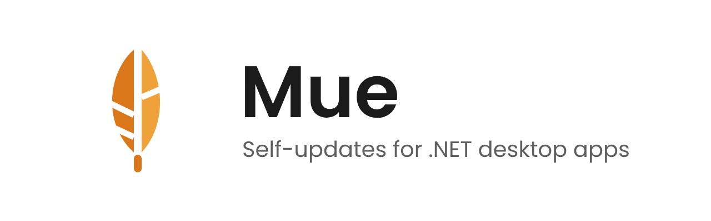

<p align="center">
  <picture>
    <source media="(prefers-color-scheme: dark)" srcset="https://raw.githubusercontent.com/syl-craft/Mue/main/docs/images/mue-banniere-sombre.png">
    
  </picture>
</p>

<p align="center">
  <b>Self-updates for .NET desktop apps.</b><br> Check, download, close what blocks, install — with the user's consent, in WPF and Avalonia.
</p>

<p align="center">
  <a href="https://github.com/syl-craft/Mue/blob/main/README.fr.md">Français</a> ·
  <a href="https://github.com/syl-craft/Mue/blob/main/docs/guide.md">Integration guide</a> ·
  <a href="https://github.com/syl-craft/Mue/blob/main/CHANGELOG.md">Changelog</a>
</p>

<p align="center">
  <picture>
    <source media="(prefers-color-scheme: dark)" srcset="https://raw.githubusercontent.com/syl-craft/Mue-media/main/videos/01-update-flow-dark.gif">
    
  </picture>
</p>

## Why Mue

- **Battle-tested.** The update engine of [DockPad](https://github.com/syl-craft/DockPad), extracted once proven in production. It now ships in DockPad, PicaLite and AlterVNC.
- **Nothing installs behind the user's back.** Mue lists the programs using your files and asks before closing them.
- **Fits your app.** Your texts, your theme, your update source; the core knows neither WPF nor Velopack.

## Features

| Feature | |
|---|---|
| 🔎 **Scheduled search** | First check 20 s after start, then every 6 h at most; cancelled on shutdown |
| 🏷️ **Version badge** | A standalone `UpdateBadge` control: `v1.2.0 → 1.3.0`, one click to the update window |
| 📝 **Release notes** | Markdown notes, progress and state in a ready-made dialog |
| 🛑 **Blocking programs** | Lists what uses your files, grouped; close some, leave the rest to the installer |
| ✅ **Explicit consent** | When your app announces side effects, the user confirms before anything happens |
| 🎨 **Themes** | Light, dark or follow Windows; your brushes win; WCAG AA contrast checked |
| 🌍 **Texts** | English and French built in; override any key, detect missing ones in your tests |
| ⌨️ **Command line** | `MyApp.exe update --json` for scripts and AI agents, with exit codes |
| 🖥️ **Platforms** | Windows (WPF, Avalonia) and macOS 15+ (Avalonia) |

## See it

<table>
  <tr>
    <td width="50%" valign="top">
      <picture>
        <source media="(prefers-color-scheme: dark)" srcset="https://raw.githubusercontent.com/syl-craft/Mue-media/main/videos/02-blockers-dark.gif">
        
      </picture>
      <p align="center"><b>Blocking programs</b><br>Close some, leave the rest to the installer</p>
    </td>
    <td width="50%" valign="top">
      <picture>
        <source media="(prefers-color-scheme: dark)" srcset="https://raw.githubusercontent.com/syl-craft/Mue-media/main/videos/04-confirmation-dark.gif">
        
      </picture>
      <p align="center"><b>Explicit consent</b><br>Esc postpones, only Confirm installs</p>
    </td>
  </tr>
  <tr>
    <td width="50%" valign="top">
      <picture>
        <source media="(prefers-color-scheme: dark)" srcset="https://raw.githubusercontent.com/syl-craft/Mue-media/main/videos/03-badge-dark.gif">
        
      </picture>
      <p align="center"><b>Version badge</b><br>Your version, until a new one is out</p>
    </td>
    <td width="50%" valign="top">
      <p><b>Command line</b></p>

```powershell
$r = & .\MyApp.exe update --json | Out-String
# {"status":"updated","current":"1.2.0",
#  "available":"1.3.0","blockers":[]}
```

<p>Exit codes for every case: up to date, updated, available, blocked, consent required.</p>
    </td>
  </tr>
</table>

## Quick start

```sh
dotnet add package Mue.Velopack
dotnet add package Mue.Wpf        # or Mue.Avalonia
```

```csharp
using Mue;
using Mue.Velopack;

UpdateTexts.AppName = "My App";

var service = new UpdateService(
    new VelopackBackend(new VelopackBackendOptions("https://github.com/you/my-app")),
    new UpdateServiceOptions { PendingStore = new FileUpdatePendingStore(pendingPath) });

service.StartPolling();                                // scheduled search
new Mue.Wpf.UpdatesDialog(service, host).ShowDialog(); // or bind an UpdateBadge
```

`host` is your `IUpdateDialogHost`: it prepares and exits your app, and finds the blocking programs. The update window
shows a discreet « Updates by Mue » credit; hide it with `new UpdatesDialogOptions { ShowCredit = false }`.
Until Mue is on nuget.org, add the local feed first: see [Local publishing](https://github.com/syl-craft/Mue/blob/main/docs/guide.md#local-publishing).

```xml
<!-- xmlns:mue="clr-namespace:Mue.Wpf;assembly=Mue.Wpf" -->
<mue:UpdateBadge VersionIndicator="{Binding Updates.VersionIndicator}" Status="{Binding Updates.Status}"
                 HasRelease="{Binding Updates.HasRelease}" Command="{Binding OpenUpdates}" />
```

## Packages

| Package | Targets | Content |
|---|---|---|
| `Mue` | net8.0, net10.0 | Engine, states, contracts, blocker detection, command line |
| `Mue.Velopack` | net8.0, net10.0 | Velopack backend |
| `Mue.Wpf` | net8.0-windows, net10.0-windows | WPF dialogs and `UpdateBadge` |
| `Mue.Avalonia` | net8.0, net10.0 | Avalonia 12 dialogs and `UpdateBadge` |

## Documentation

- [Integration guide](https://github.com/syl-craft/Mue/blob/main/docs/guide.md): host contract, consent, command line, texts, themes, WPF and Avalonia resources, blocker detection, tests.
- [Changelog](https://github.com/syl-craft/Mue/blob/main/CHANGELOG.md) (in French).
- [Sample app](https://github.com/syl-craft/Mue/tree/main/samples/Mue.Sample.Wpf): a « Notebook » app with a simulated update.

## License

MIT, see [LICENSE](https://github.com/syl-craft/Mue/blob/main/LICENSE).
